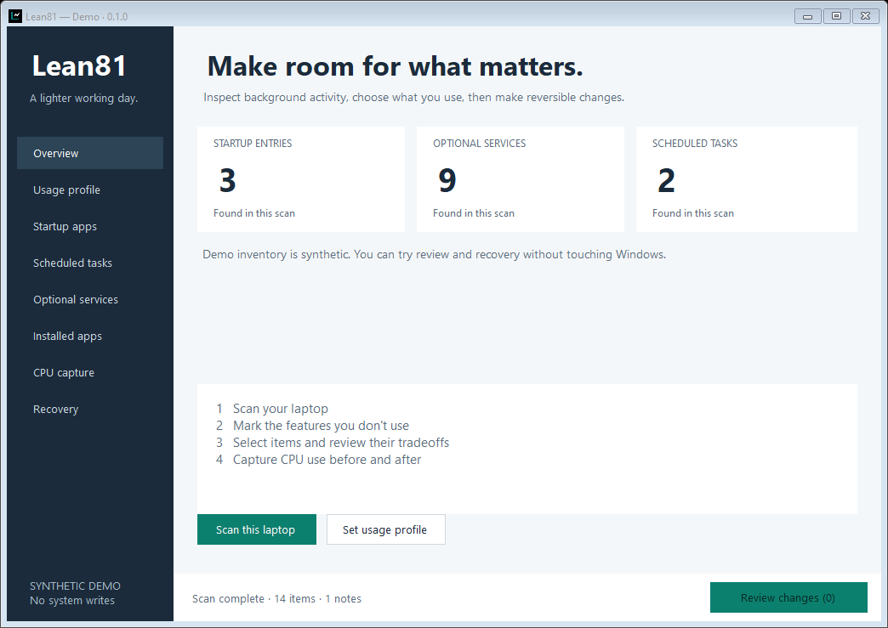
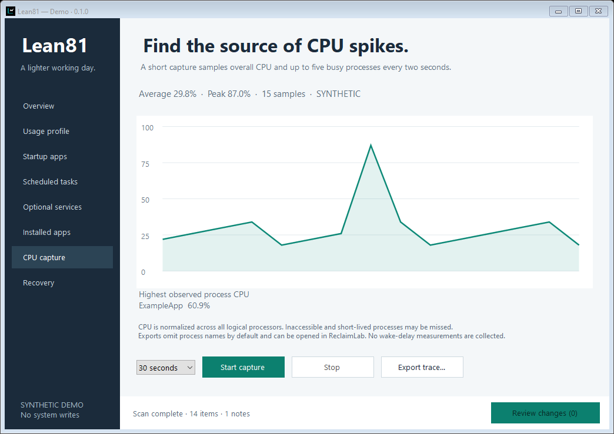

# Lean81

**A lighter working day for older Windows laptops.**

Lean81 is a small native Windows app for inspecting background load and making deliberate, reversible changes. Built for Windows 8.1 laptops with limited CPU and memory. C# / Windows Forms, no Python runtime, bundled browser, telemetry, account or permanent service.

[Download the preview](https://github.com/HamWebDevs/Lean81/releases/tag/v0.1.0) · [Quick start](docs/QUICKSTART.txt) · [Recovery](docs/RECOVERY.md) · [Compatibility](docs/COMPATIBILITY.md)



Screenshots show the actual Windows app with synthetic demo data.

## What you can do

- Inspect Run startup entries and select recognized apps to stop launching at sign-in.
- Review scheduled tasks; system, recognized security and hardware tasks are kept for inspection.
- Describe which optional Windows features you use. Only unused allowlisted services without non-disabled dependents become selectable.
- List installed desktop apps and open the normal Windows uninstaller.
- Capture CPU, available memory and busy processes at two-second intervals; export a privacy-conscious JSONL trace compatible with [ReclaimLab](https://github.com/HamWebDevs/ReclaimLab).
- Review every selected change and its tradeoff, save original settings before writing, and restore them through conflict-aware recovery.

Nothing is disabled automatically. Lean81 does not promise a faster CPU: an idle background item may cost almost nothing. Capture the same workload before and after to see which changes help your machine.



## Run it

1. Download and extract **Lean81-0.1.0-portable.zip** from Releases.
2. Open **Lean81.exe**. Scan without administrator rights.
3. Review startup items, and keep uncertain usage-profile features checked.
4. Enable changes when ready, select individual items, and read the review screen.
5. Use **Recovery** to restore saved settings. Keep `%ProgramData%\Lean81` and don't share its private receipt files.

The release also includes a standalone **Lean81.exe**. Windows 8.1 includes the target .NET Framework 4.5.1. The portable ZIP includes the runtime-selection configuration, local instructions and license. No install step is needed. For a safe tour, run `Lean81.exe --demo` with synthetic data.

**0.1.0 is an unsigned preview.** The code and managed APIs target Windows 8.1. Automated Windows checks run on Server 2022; physical Windows 8.1 validation is pending. See [compatibility and limits](docs/COMPATIBILITY.md) before applying changes.

## Deliberate boundaries

Networking, security, core OS and update services stay outside the service allowlist. No registry cleaner, memory cleaner, blanket process killing, driver removal, pagefile changes, kernel/timer tweaks or automatic app uninstalls are included. Startup commands, task actions and uninstall strings are never executed during inspection.

Service changes preserve start type, delayed-auto flag and original running state. Startup changes preserve the exact Run string and registry kind. Task changes preserve the task definition and change only its enabled state. Recovery stops when an item no longer matches either its original or expected disabled state. Windows does not provide a single atomic transaction across these subsystems; a partial failure is recorded for review.

## Build and test

On Windows with .NET Framework's C# compiler, PowerShell and Git:

```powershell
./scripts/build.ps1 -Test -Gui -Package
```

The script downloads Microsoft's pinned reference-assembly package (build time only), verifies its SHA256 and compiles using C# 5 against .NET Framework 4.5.1. Output is in `artifacts/`. It builds a WinExe and a separate console test runner, captures demo screenshots and creates portable/source ZIPs with SHA256 checksums.

Native mutation fixtures run only on explicitly opted-in ephemeral Windows CI. They create uniquely named Run/task entries, never execute their commands, and clean up in `finally` blocks. No real installed service is toggled. The suite also checks native CPU capture and protected recovery storage. Ordinary local tests use in-memory backends.

| Area | Implementation |
| --- | --- |
| Interface | Native Windows Forms, on-demand work, small-window layout |
| Change policy | Fixed optional-service allowlist and protected task/startup heuristics |
| Transactions | Fresh-state checks, intent journal, post-write verification |
| Recovery | Admin/SYSTEM storage, exact-state checks, whole-batch restore preflight |
| Diagnostics | GetSystemTimes, GlobalMemoryStatusEx, process-time deltas |
| Release | Windows build and fixtures, GUI evidence, portable/source ZIPs, SHA256 |

Contributions: read [AGENTS.md](AGENTS.md), [CONTRIBUTING.md](CONTRIBUTING.md), and the safety boundaries before adding system changes. Public credit: **HamWebDevs**. MIT licensed.
