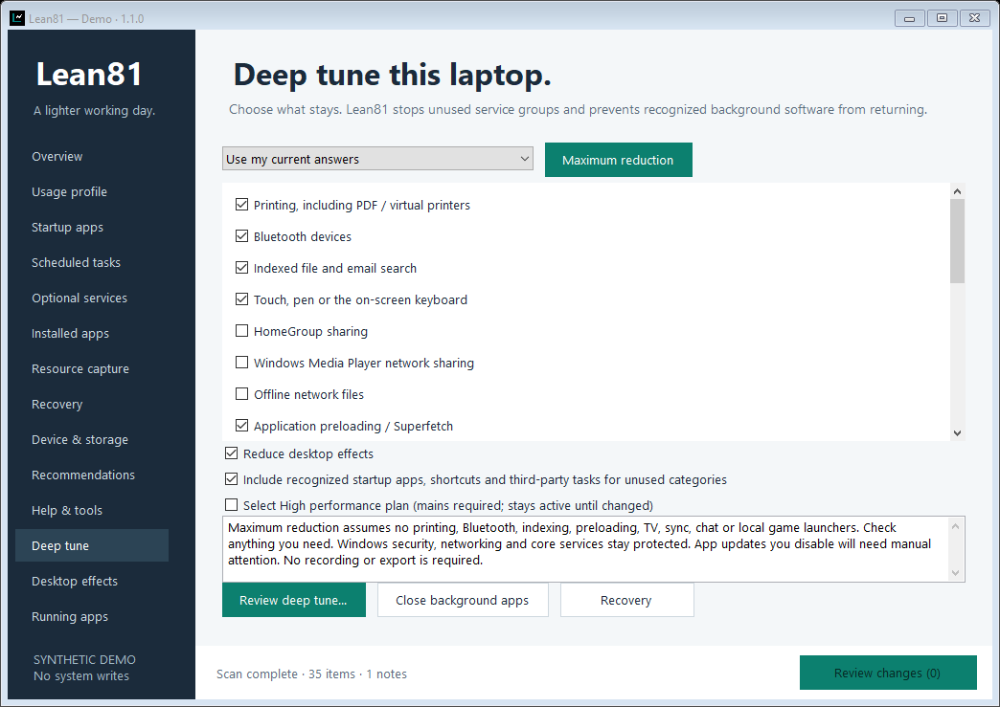
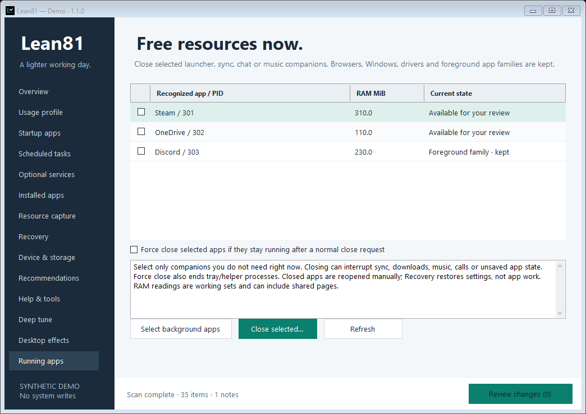

# Lean81

**Actively cut background load on an older laptop.**

Lean81 stops reviewed unused services, prevents recognized background software from returning at sign-in, and closes selected companion apps inside the same small Windows app. It targets Windows 8.1 / .NET Framework 4.5.1 and needs no Python, bundled browser, installer or permanent service.

[Download Lean81 1.1](https://github.com/HamWebDevs/Lean81/releases/tag/v1.1.0) · [Quick start](docs/QUICKSTART.txt) · [Deep-tune guide](docs/FEATURES.md) · [Recovery](docs/RECOVERY.md)



## Start here

1. Extract **Lean81-1.1.0-portable.zip** and open **Lean81.exe**.
2. In **Deep tune**, click **Maximum reduction**. Check anything you need to keep: this preset assumes no printing, Bluetooth, indexing, Superfetch, TV, sync, chat or local game launchers. Compatibility assistance and Windows themes stay kept unless you opt out.
3. Choose **Review deep tune**, read the actual installed items and apply. Services are stopped now and kept disabled. Startup changes prevent future launches. If administrator permission is needed, use the same Windows account and build the review again after elevation.
4. Open **Running apps** to close selected recognized companions now. Normal close is the default; force close is a separate option for tray/helper processes. Review the list before closing anything.
5. Use **Recovery → Restore tune group** to undo a whole tune. Closed apps and their unsaved state are not restored automatically; reopen apps yourself.

No capture, external analysis app or trace export is needed to tune the laptop.

## What changed in 1.1

- **Dependency-aware deep tuning:** an unused service provider can now be stopped after its reviewed dependents. Batches share one recovery group and restore in the reverse dependency order.
- **26 optional service choices:** includes indexing, Superfetch, sharing, printing, scanning, Media Center, optional diagnostic reporting/helpers, compatibility assistance, themes and selected app updater/launcher services. Only installed services are shown.
- **Broader startup control:** supported Run entries plus bounded user/common Startup-folder `.lnk` and `.url` shortcuts. Original shortcut files move to protected same-volume backups; recovery preserves bytes, timestamps, ownership and permission rules.
- **Recognized startup/task selection:** unused launcher, sync, chat, music and updater categories can enter the deep-tune review. Unknown entries require individual review; Microsoft/system scheduled tasks stay inspection only.
- **Close apps now:** a fixed companion catalog, same-user/session checks, fresh PID/creation-time checks, critical-process protection and foreground-family protection. No blanket process killing, browser closure or automatic relaunching.
- **Optional performance plan:** select an existing High performance power plan while on mains power. It can use more energy and produce more heat; it stays active until changed or restored. No power-plan internals are rewritten.



## A way back

Original settings are saved before each configuration batch, then checked after writing. Recovery checks a tune group before restoring it and refuses independent edits. Windows does not provide one atomic transaction for all these components: a failed operation can leave earlier changes applied, with receipts for inspection.

Keep `%ProgramData%\Lean81`, including its startup backups, and `%LocalAppData%\Lean81` when upgrading. Existing 0.1–1.0 receipts and workspaces remain supported. New feature answers default to kept when absent from older preferences.

## Measurements and limits

On-demand CPU/RAM/disk capture, process leaders, reports and baseline comparisons remain in the app for optional investigation. Nothing monitors continuously after capture or after Lean81 closes.

Lean81 cannot know every feature you use or turn an older CPU into newer hardware. An idle service may cost almost nothing; disabling prefetch can slow launches. Available RAM is managed by Windows, so no working-set trimming or fake RAM-cleaner score is used. No particular speed increase is promised.

Networking, security, input, core OS and Windows Update stay protected. No registry cleaner, driver removal, pagefile/timer/kernel tweak or automatic app uninstall is included. Inspection never executes discovered commands, task actions or uninstall strings.

The EXE is unsigned. Windows 8.1 is the managed/native API target; automated tests use Windows Server 2022 and physical Windows 8.1 testing remains pending. See [compatibility](docs/COMPATIBILITY.md), [privacy](docs/PRIVACY.md) and [feature details](docs/FEATURES.md).

## Build and test

```powershell
./scripts/build.ps1 -Test -Gui -Package
```

C# 5 compiles against pinned Microsoft .NET Framework 4.5.1 reference assemblies. CI adds isolated dependency/recovery/policy tests, disposable native Run/task/shortcut/process fixtures, a read-only x86 resource probe, GUI smoke/screenshots at two sizes and Chromium/mobile/print report verification. It never toggles a real installed service, existing task or existing app process during testing.

Public owner: **HamWebDevs**. MIT licensed. Read [AGENTS.md](AGENTS.md) and [CONTRIBUTING.md](CONTRIBUTING.md) before contributing.
