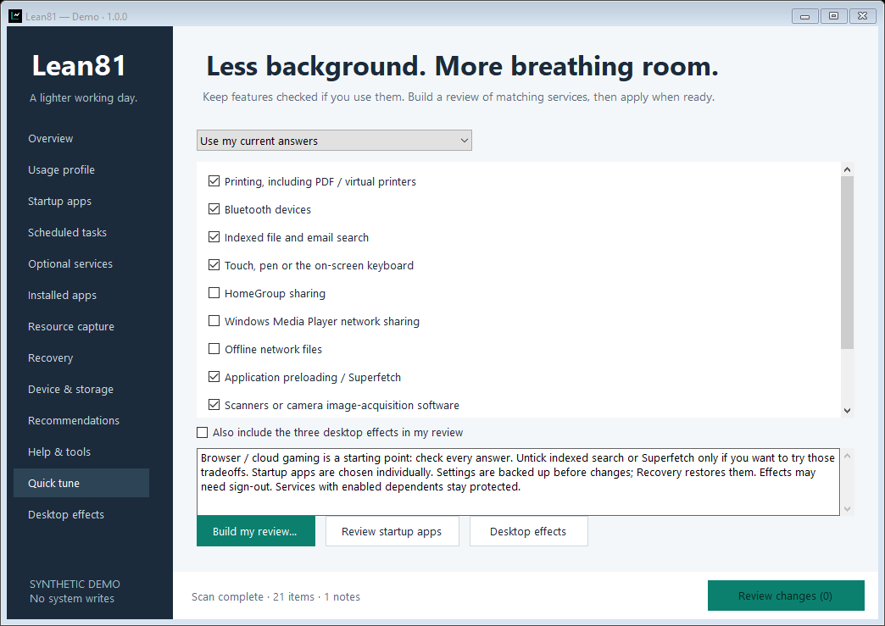
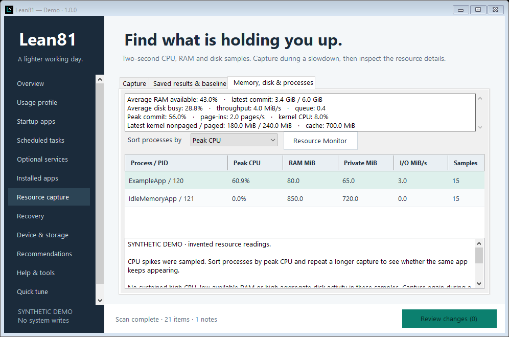

# Lean81

**Make room for what you use.**

A small native Windows app for older laptops that struggle with CPU spikes, limited RAM and busy disks. Choose unused features, review reversible changes and capture what is happening during a slowdown. Built for **Windows 8.1 / .NET Framework 4.5.1**. No Python, bundled browser, installer or permanent service.

[Download Lean81 1.0](https://github.com/HamWebDevs/Lean81/releases/tag/v1.0.0) · [Quick start](docs/QUICKSTART.txt) · [Feature guide](docs/FEATURES.md) · [Recovery](docs/RECOVERY.md)



## New in 1.0

- **Quick tune:** answer what you use, optionally include desktop effects, then build one explicit review. Original settings are saved before any changes.
- **Browser / cloud gaming preset:** a starting point for a laptop mainly used for browsing and streaming games. Printing, Bluetooth, search and Superfetch stay checked until you choose otherwise.
- **13 optional services:** includes separate choices for scanning, portable-device synchronization, error reporting and moved-file link tracking. Unused features and dependency checks control eligibility.
- **Reversible desktop effects:** taskbar animations, desktop Peek and icon-label shadows. Restore the exact original DWORD or its original absence; sign out and back in to refresh Explorer.
- **Resource capture:** CPU, available RAM, disk activity/throughput/queue, page-ins, commit pressure and kernel pools. Missing counters remain unknown.
- **Sortable process leaders:** CPU, working-set RAM, private memory and read/write I/O, including memory-heavy apps that use little CPU. Up to 20 accessible leaders per sample.
- **Better evidence:** CPU/RAM/disk charts, qualified findings, resource summaries in local reports and disk comparisons only when both captures have complete disk coverage.



## Get started

1. Download **Lean81-1.0.0-portable.zip**, extract it and open **Lean81.exe**. The standalone EXE is also attached to the release.
2. Open **Quick tune**. Pick **Browser / cloud gaming laptop** if useful, then check every answer. Keep a feature checked if you use it or are unsure.
3. To experiment with indexing or Superfetch, untick those specific answers and read the tradeoffs. Disabling preloading can slow app launches.
4. Choose **Build my review**, read the list and apply. If Windows asks for administrator permission, use the same account; the elevated app rescans and you build the review again.
5. In **Startup apps**, select recognized apps you do not need at sign-in. Use **Scheduled tasks** and **Installed apps** for further individual review.
6. Open **Resource capture**, record 30–120 seconds during a slowdown and inspect **Memory, disk & processes**. Set a baseline and repeat the same workload after changes.
7. Use **Recovery** to inspect or restore original settings. Keep `%ProgramData%\Lean81` and `%LocalAppData%\Lean81` when upgrading.

An idle service may cost almost nothing. A two-second sample can miss a brief spike. Process I/O includes network and device operations and is **not** per-process disk utilization. Aggregate disk readings can hide a single busy drive. Lean81 helps identify useful changes; it cannot guarantee a particular speed improvement.

## Recovery and boundaries

Every change uses an allowlisted backend, fresh-state checks, a protected intent journal and post-write verification. Recovery checks the whole pending receipt before writing and stops for independent edits. Existing 0.1–0.3 receipts and saved workspaces remain supported.

Networking, security, input, core OS and update services remain protected. No RAM cleaner, registry cleaner, blanket process killing, pagefile/timer/kernel tweaks, driver removal or automatic uninstallation is included. Inspection never runs discovered startup commands, task actions or uninstall strings. Desktop settings are a fixed three-value allowlist, not arbitrary registry editing.

**The EXE is unsigned.** Windows 8.1 is the API target; physical Windows 8.1 testing remains pending. Automated checks use Windows Server 2022. See [compatibility and diagnostic limits](docs/COMPATIBILITY.md) and [local data/privacy](docs/PRIVACY.md).

## Build and test

On Windows with .NET Framework's C# compiler, PowerShell and Git:

```powershell
./scripts/build.ps1 -Test -Gui -Package
```

The script downloads pinned Microsoft 4.5.1 reference assemblies at build time, verifies their hash, compiles C# 5 and creates the portable EXE/ZIP, source ZIP and SHA256 checksums. No build dependencies are downloaded by the released app.

CI also runs disposable native Run/task fixtures on an explicitly opted-in ephemeral Windows runner, real resource capture and a read-only x86 resource-layout probe and device checks, GUI smoke/screenshot checks at two sizes, and browser/print verification of Windows-generated reports. Real installed services and existing scheduled tasks are never toggled by tests. Desktop-setting writes use isolated in-memory tests; native checks only inspect those values.

Public owner: **HamWebDevs**. MIT licensed. Read [AGENTS.md](AGENTS.md) and [CONTRIBUTING.md](CONTRIBUTING.md) before contributing.
